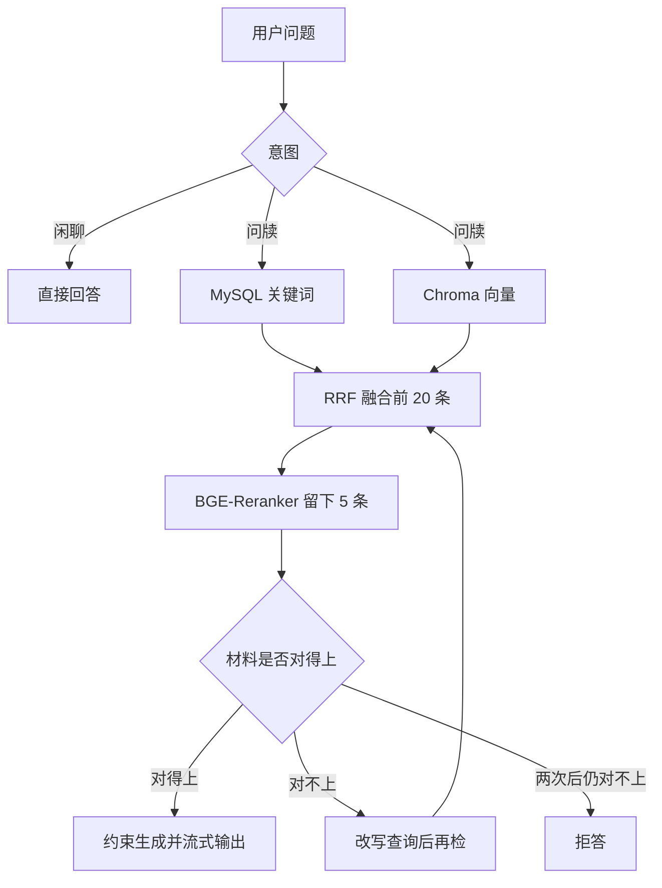

# 问牍·青声

**问牍·青声 —— RAG与多角色AI驱动的简牍社交学习平台**：Vue 3 + Flask，MySQL / Redis / Neo4j / ChromaDB，DeepSeek API。

## 安全说明

请勿将 `DEEPSEEK_API_KEY` 写入仓库。若密钥曾出现在聊天或文档中，建议在 DeepSeek 控制台轮换。

**管理端**：在 `.env` 设置 `ADMIN_TOKEN` 后，页脚「运维」进入 `/admin`，请求头携带 `X-Admin-Token`。勿泄露该令牌。

## 环境要求

- Python 3.10+
- Node.js 18+
- MySQL 8.0
- Redis、Neo4j、ChromaDB（可按模块逐步启用）

## 后端

```bash
cd backend
python -m venv .venv
.venv\Scripts\activate
pip install -r requirements.txt
copy .env.example .env
# 编辑 .env：MySQL 密码、DEEPSEEK_API_KEY、可选 ADMIN_TOKEN
mysql -u root -p < scripts/create_db.sql
python scripts/seed_demo.py
# 若库已存在但缺徽章定义：
python scripts/seed_badges_only.py
# 戍边手记三步任务（与 /quests 页对应，可重复执行、已存在则跳过）：
python scripts/seed_quest_templates.py
python wsgi.py
```

生产可用：`gunicorn -w 4 -b 0.0.0.0:5000 "wsgi:app"`。

## 前端

```bash
cd frontend
npm install
npm run dev
```

边塞夜话页含 **立绘（`public/chat-portraits/*.svg`）** 与可选 **Three.js 三维小影**；依赖 `three`。可选将低面数 `idle.glb` 置于 `public/models/chat/idle.glb`，无文件时自动使用程序生成的低面数占位模型。

浏览器访问 `http://localhost:5173`，API 经 Vite 代理到 `http://127.0.0.1:5000`。

`npm run build` 会生成 **PWA**（`dist/sw.js`），可缓存静态资源；简牍全文与 API 仍依赖网络。

## 界面与体验

- 全局样式：`frontend/src/styles/theme.css`；**深色护眼**：顶栏「外观」或跟随系统（`html.dark` + Element Plus 暗色变量）。
- **新手引导**：Element Plus `el-tour`，首次进书斋触发；书斋内可点「新手引导」重播；关于页可清除完成标记。
- **无障碍**：跳过导航链接、可见焦点环、图谱/对话框部分 `aria-*`。

## 主要路由（前端）

| 路径 | 说明 |
|------|------|
| `/home` | 书斋、问牍、入门六径 |
| `/browse` | 牍库检索 |
| `/slip/:id` | 简牍详情（可分享 URL） |
| `/debate` | 辩论社（辩题可读 `GET /api/public/debate-topics`） |
| `/admin` | 运维：敏感词、辩题、每日简牍、**问牍向量重建**、埋点汇总 |
| `/legal/terms` `/legal/privacy` `/legal/ai` | 用户协议、隐私政策、AI 生成内容说明（试运行稿） |

## 试运行与安全相关（已实现）

- **JWT**：登录/注册返回 `access_token` + `refresh_token`；`POST /api/auth/refresh`（`Authorization: Bearer <refresh_token>`）换取新访问令牌。`.env` 中 `JWT_ACCESS_MINUTES` 留空或 `0` 表示访问令牌永不过期（仅建议本地）；正式试运行请设为 `60`～`120` 等。`JWT_REFRESH_DAYS` 控制刷新令牌天数（默认 30）。
- **限流**：Flask-Limiter，默认全站 `RATELIMIT_DEFAULT`（如 `120 per minute`）；登录/注册、问牍、辩论、快读、埋点、聊天发消息等另有单独上限。`/api/media/*` 与 `/api/health` 不计入限流。多实例请设置 `RATELIMIT_STORAGE_URI` 为 Redis 等与 `REDIS_URL` 一致的存储。
- **健康检查**：`GET /api/health` 返回 `status` 与 `checks`（MySQL、DeepJiandu `test` 目录是否存在）；`GET /api/health/ready` 在数据库不可用时报 **503**，便于编排就绪探针。
- **自动化测试**（SQLite 内存库，不依赖 MySQL）：在 `backend` 执行 `pytest tests/ -q`。问牍的融合、改写和拒答逻辑在 `tests/test_rag_agent.py`，不调用大模型。

## 问牍链路

用户问题先判断是不是闲聊。闲聊直接回答，不查牍库。问牍时，关键词和向量各召回 20 条，用 RRF（`1/(60+排名)`）合成一份，再交给 `BAAI/bge-reranker-base` 把这 20 条精排后留下 5 条。材料里对不上问题里的词，就改写查询再检，最多两次；仍然对不上就拒答，不生成编造的绎读。这个判断看的是关键词有没有出现在材料里，不是重排分数。流式接口用 SSE 推送当前步骤和逐字正文，结束后附上可展开的简牍释文。



本机 `.env` 打开了两路检索和重排（`RAG_USE_CHROMA=1`、`RAG_USE_RERANK=1`、`RAG_POOL=20`）。向量库是用本地 bge-m3 重建的 `chroma_data_v2`。代码默认仍是关闭，换一台没有模型文件的机器不会在启动时去拉权重。

评测不使用外部宣传用的分数。在 `backend` 有两份：

```bash
python evaluation/run_eval.py
python evaluation/run_ranking_eval.py
```

`run_eval.py` 读 `eval_dataset.json`（库内 20、库外 12、闲聊 4），只看检索、拒答和闲聊分流。库内题看前 3 条正文里有没有一段预期文字。最近一次、且当时向量关闭时：库内 Recall@3 为 1.00，库外 12 题都拒答，闲聊 4 题都没去检索，平均检索 82.3ms。预期文字往往就是问题里的词，这个 1.00 不能当成检索提升。

`run_ranking_eval.py` 读 `eval_ranking.json`，40 题都带标准简号。四列都在同一批评测上跑，指标是 Hit@5 和 MRR@5。没进前 5 名的题，倒数排名记 0。最近一次结果写在 `evaluation/ranking_results.json`：

| 通路 | Hit@5 | MRR@5 |
|---|---:|---:|
| 只关键词 | 0.975 | 0.9625 |
| 只向量 | 0.625 | 0.5092 |
| RRF | 0.925 | 0.7967 |
| RRF + BGE 重排 | 0.925 | 0.6425 |

这 40 题里，前 10 题是白话问法，后 30 题是释文里较少见的 8 字片段。片段题对关键词很有利。按这次结果，两路融合和重排都没有超过只做关键词。不能把这张表说成“融合之后提升了命中率”。

## API 摘要

- 简牍：`GET /api/slips`（分页 `page`/`size`/`q`；**游标** `after_id`+`size`+`q` 返回 `has_more`/`next_after_id`，无 `total`）、`GET /api/slips/<id>`
- 问牍：`POST /api/rag/query` 返回 `answer`、`references`、`refused` 和 `rag_meta.steps`；`POST /api/rag/query/stream` 为 SSE，事件有 `status`、`token`、`done`。
- 问牍索引：`POST /api/rag/reindex`（须 **`X-Admin-Token`**，与 `ADMIN_TOKEN` 一致；命令行可用 `curl -H "X-Admin-Token: xxx" -X POST ...`）
- 徽章：`GET /api/public/badges`、`GET /api/user/badges`（需登录）
- 埋点：`POST /api/analytics/event`（`event_type`、`path`、`meta`）
- 认证：`POST /api/auth/login`、`POST /api/auth/register`、`POST /api/auth/refresh`（刷新令牌）、`POST /api/auth/logout`（需访问令牌）
- 管理：`GET/PUT /api/admin/kv/blocked_words|debate_topics`、`POST /api/admin/daily`、`POST /api/admin/graph/sync-neo4j`、`GET /api/admin/analytics/summary?days=7`（均需 `X-Admin-Token`）

发帖审核会合并**内置敏感词**与 KV 中 **`blocked_words` JSON 数组**。

## DeepJiandu 数据

1. **解压到项目根**（与仓库内示例一致即可）：
   - 标注：`DeepJiandu_labels/DeepJiandu_labels/{train,val,test}/*.xml`（Pascal VOC，`<object><name>` 为单字，常含 `&#xxxx;` 实体）
   - 影像：`DeepJiandu/{train,val,test}/*.bmp`（与 XML 中 `<filename>` 同名）
2. **后端 `.env`**：`DEEPJIANDU_IMAGE_ROOT` 指向含 `train/val/test` 的影像根目录，默认可不填（使用项目根下 `DeepJiandu`）。
3. **导入 MySQL**（在 `backend` 目录、虚拟环境已激活）：

```bash
python scripts/import_deepjiandu.py --limit 100
python scripts/import_deepjiandu.py --reindex
```

导入后每条简牍的 `image_url` 形如 `/api/media/deepjiandu/{split}/{filename}`，开发时由 Vite 代理到 Flask；**生产**建议把文件同步到对象存储/CDN，再将库中 `image_url` 批量改为 `https://你的域名/...`，可停用本地 `GET /api/media/deepjiandu/...`。

占位说明仍可见：`python scripts/prepare_deepjiandu.py`。

## 数据已导入后的优化建议

1. **问牍 / RAG**：在 `.env` 配置 `ADMIN_TOKEN` 后，用管理页「问牍索引」或 `POST /api/rag/reindex` 并携带 **`X-Admin-Token`**；导入脚本 `import_deepjiandu.py --reindex` 仍直接调同步函数，无需 HTTP。全量同步为**分批 upsert**（`CHROMA_UPSERT_BATCH`，默认 256）。
2. **牍库关键词检索**：无索引时 `LIKE %关键词%` 在大表上较慢。可在 MySQL 维护窗口执行 `backend/scripts/optimize_slips_mysql.sql`（ngram 全文索引），然后在 `.env` 设置 **`SLIPS_USE_FULLTEXT=1`** 并重启后端；`GET /api/slips?q=` 与 RAG 回退关键词检索会走 `MATCH ... AGAINST`。
3. **影像**：`.bmp` 体积大，试运行可接受；正式对外建议转 **WebP/JPEG** 上 CDN/OSS，并批量更新 `image_url`。
4. **运维**：用 `GET /api/health/ready` 做就绪探针；限流存储改为 Redis（`RATELIMIT_STORAGE_URI`）以支撑多实例。

## Neo4j 简牍子图（tags / 人物 / 遗址）

- **同步**：运维页「Neo4j 图谱」或 `POST /api/admin/graph/sync-neo4j`（JSON 可含 `limit`，默认 500，需 `X-Admin-Token`）；命令行：`python scripts/sync_neo4j_from_slips.py [条数]`。
- **模型**：`(:Slip {code, slip_id, title})`，`(:Slip)-[:HAS_TAG]->(:Tag)`（`tags` 按逗号/分号拆分），`(:Slip)-[:MENTIONS_PERSON]->(:Person)`（标签项形如 **`人:姓名`** 或 **`人物:姓名`**），`(:Slip)-[:AT_SITE]->(:Site)`（`site_name`）。
- **前端**：`/graph` 调用 `GET /api/graph/subgraph` 展示上述节点类型。
- **手工示例**：`GET /api/graph/seed-cypher` 返回补充用 Cypher。

## 文档知识包（给协作者 / 其他 AI 填 Word）

不附带完整源码时，可将 **`docs/`** 目录整体发送：含 **`docs/项目知识包.md`**（主文档）、**`docs/openapi.yaml`**、环境变量、管理端手册、ER 图、用户旅程与截图清单，以及可拆分的 `01_`～`03_` 精简稿。索引见 **`docs/README.md`**。

## 上线成熟度（经验估计）

演示级功能闭环约 **70～80%**（已含 JWT 刷新雏形、基础限流、健康检查、法务/AI 声明页与最小 pytest）。距稳定生产仍需：**HTTPS 与反向代理**、密钥与 Cookie 策略、**监控告警与数据库备份**、内容**人审流程**、更完整的**集成/E2E 测试与压测**。详见站内 **关于** 页说明。
